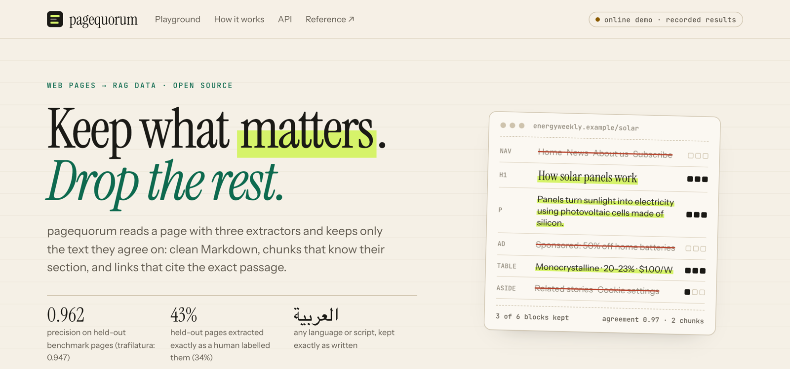
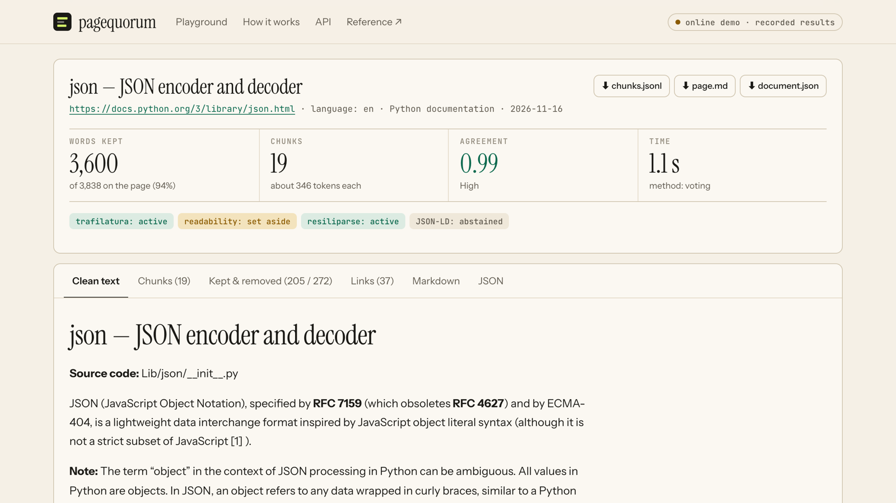
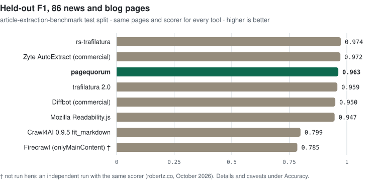
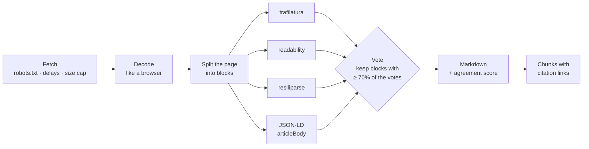

<div align="center">

<a href="https://manishmaurya89.github.io/pagequorum/">
  <picture>
    <source media="(prefers-color-scheme: dark)" srcset="docs/images/hero-dark.png">
    
  </picture>
</a>

# pagequorum

**Turn web pages into clean Markdown for RAG and AI agents.**<br>
Three extractors vote on every block of a page, and only what they agree on is kept.

[](https://github.com/Manishmaurya89/pagequorum/actions/workflows/tests.yml)
[](pyproject.toml)
[](LICENSE)
[](#use-it-from-an-ai-assistant-mcp)
[](https://manishmaurya89.github.io/pagequorum/)

**[Try the online demo](https://manishmaurya89.github.io/pagequorum/)** ·
[Quick start](#quick-start) ·
[AI assistants (MCP)](#use-it-from-an-ai-assistant-mcp) ·
[Accuracy](#accuracy) ·
[How it works](#how-it-works)

</div>

---

Getting the main text out of a web page is the step most RAG pipelines get quietly
wrong. Menus, cookie banners, "related stories" and footers leak into the index, while
code blocks, tables and headings get flattened or dropped. Each popular extractor has
its own blind spots, and none tells you when it failed.

pagequorum doesn't add another heuristic. It asks several proven extractors and keeps
only the parts they agree on.

## Why pagequorum

- 🎯 **Less boilerplate in your index.** On held-out benchmark pages, precision is 0.962,
  where trafilatura gets 0.947: a small gain, about two standard errors. On 43% of those
  pages the output is *exactly* the human-labelled article text; trafilatura manages 34%.
  Overall F1 is a tie ([details](#accuracy)).
- 🚦 **It tells you when a page was hard.** Every page gets an agreement score. In the
  benchmark, the 5 pages where extraction went wrong (F1 < 0.8) averaged 0.75 and the
  other 176 averaged 0.89. Five pages are a hint, not proof, but low scores are the ones
  worth a look.
- 🧱 **Structure survives.** Headings, nested lists, tables (header repeated when split),
  fenced code with its language, block quotes and footnotes come out as Markdown.
- 🔗 **Chunks that cite their source.** Each chunk knows its section path and its exact
  span in the Markdown. Its `#:~:text=` link opens the live page scrolled to that passage.
- 🌏 **Text in any script is kept as written.** Pages are decoded like a browser does:
  a UTF-8 page served as `ISO-8859-1` is fixed, so `’` doesn't become `’`. Checked
  on Hindi and English Wikipedia.
- 🤖 **Works inside AI assistants.** `pagequorum mcp` gives Claude, Cursor, VS Code and
  other MCP clients `scrape`, `crawl` and `map_site` tools.
- 🏠 **Free, local, polite.** No API key and no account. It respects robots.txt, waits
  between requests to the same site and caps download size.

<a href="https://manishmaurya89.github.io/pagequorum/">
  <picture>
    <source media="(prefers-color-scheme: dark)" srcset="docs/images/scrape-dark.png">
    
  </picture>
</a>
<p align="center"><sub>The web app on the Python <code>json</code> docs. Readability covered less than
half of what the others did on this long page, so it was set aside and the other voters decided.
<a href="https://manishmaurya89.github.io/pagequorum/">Try it in the browser</a>.</sub></p>

## Quick start

```bash
pip install "pagequorum[web] @ https://github.com/Manishmaurya89/pagequorum/archive/refs/heads/main.zip"
```

```bash
pagequorum scrape https://docs.python.org/3/library/json.html     # Markdown to stdout
pagequorum crawl https://www.python-httpx.org/ -o out/ --max-pages 50
pagequorum serve --open                                            # the web app, on 127.0.0.1
pagequorum mcp                                                     # MCP server for AI assistants
```

```python
import pagequorum as pq

doc = pq.scrape("https://docs.python.org/3/library/json.html")
print(doc.markdown)
for chunk in doc.chunks(max_tokens=512):
    embed(chunk.contextualized(), cite=chunk.citation_url)
```

`embed` stands for your own embedding call. A chunk, as `pagequorum scrape URL -f chunks`
prints it (shortened):

```json
{
  "text": "Other than the *ensure_ascii* parameter, this module is defined strictly in terms of conversion between Python objects and `Unicode strings`, and thus does not otherwise directly address the issue of character encodings.",
  "heading_path": ["json — JSON encoder and decoder", "Standard Compliance and Interoperability", "Character Encodings"],
  "tokens": 55,
  "citation_url": "https://docs.python.org/3/library/json.html#:~:text=Other%20than%20the%20ensure_ascii%20parameter%2C%20this"
}
```

## Use it from an AI assistant (MCP)

`pagequorum mcp` is an [MCP](https://modelcontextprotocol.io) server. Assistants that
support MCP can read web pages with it, including Claude Code, Claude Desktop, Cursor
and VS Code. It offers four read-only tools:

| tool | what the assistant gets |
|---|---|
| `scrape` | one page as clean Markdown, headed by the extractors' agreement |
| `crawl` | a site section (up to 50 pages), each page as Markdown |
| `map_site` | the site's page URLs, from its sitemap and links |
| `extract_html` | clean Markdown from HTML the assistant already has (no network) |

Setup needs [uv](https://docs.astral.sh/uv/); `uvx` fetches and runs pagequorum on
demand. For Claude Code:

```bash
claude mcp add pagequorum -- uvx --from "pagequorum[mcp] @ https://github.com/Manishmaurya89/pagequorum/archive/refs/heads/main.zip" pagequorum mcp
```

For Claude Desktop (`claude_desktop_config.json`), Cursor (`~/.cursor/mcp.json`) and
most other clients:

```json
{
  "mcpServers": {
    "pagequorum": {
      "command": "uvx",
      "args": ["--from", "pagequorum[mcp] @ https://github.com/Manishmaurya89/pagequorum/archive/refs/heads/main.zip",
               "pagequorum", "mcp"]
    }
  }
}
```

VS Code (`.vscode/mcp.json`) uses `"servers"` instead of `"mcpServers"`, with
`"type": "stdio"` added. Without uv: `pip install "pagequorum[mcp] @ <the same URL>"`
and use `"command": "pagequorum", "args": ["mcp"]`.

The assistant gets the agreement score at the top of every page, so it knows when to
double-check:

```text
Source: https://en.wikipedia.org/wiki/Retrieval-augmented_generation | Retrieval-augmented generation
Kept 1,730 of 3,521 words | extractor agreement 0.97 (high)

---

# Retrieval-augmented generation

**Retrieval-augmented generation** (**RAG**) is a technique that enables large language models …
```

**Safety.** The URLs come from a model, which may have just read a page telling it to
fetch something it should not. So the tools refuse private-network addresses
(localhost, 10.x, 192.168.x, cloud metadata at 169.254.169.254, ...), including
redirects into them and host names that resolve to them. The check is made on the
address each connection actually opens, so a DNS answer that changes after the check
(DNS rebinding) does not get through. Behind an HTTP or SOCKS proxy (`HTTPS_PROXY`,
`ALL_PROXY`), the proxy resolves names itself and only the name check applies. To read
your own development server, set `PAGEQUORUM_ALLOW_PRIVATE=1` in the server's `env`.
robots.txt and the per-site delay apply as usual.

## Accuracy

<picture>
  <source media="(prefers-color-scheme: dark)" srcset="docs/images/f1-dark.svg">
  
</picture>

Measured on the [article-extraction-benchmark](https://github.com/scrapinghub/article-extraction-benchmark),
181 real news and blog pages with human-labelled article text. Scoring is identical to
the benchmark's own: token 4-gram precision and recall per page. Pages are split by id
into **dev** (95 pages, the only ones used for every design and tuning decision) and
**test** (86 held-out pages).

What this does and does not show:

- pagequorum is **not** the most accurate extractor here. On held-out pages,
  rs-trafilatura and Zyte's commercial AutoExtract score about 0.01 F1 higher. On 86
  pages that gap is within the margin of error (paired bootstrap: −0.011 ± 0.012 against
  rs-trafilatura), so read the top six as close, not as a ranking. rs-trafilatura keeps
  more of the article (recall 0.989 vs 0.964) and AutoExtract keeps less boilerplate
  (precision 0.986 vs 0.962).
- Against its own voters, pagequorum's held-out F1 **ties** trafilatura 2.3 (0.963). The
  gain is **precision**: 0.962 vs 0.947 held out (+0.015 ± 0.007 in a paired bootstrap:
  small, about two standard errors), which means less boilerplate in your index. The
  output is also exactly the labelled article body on **43%** of held-out pages, against
  34% (95% interval for the difference: +2 to +17 points). The price is slightly lower
  recall (0.964 vs 0.978).
- Crawl4AI keeps nearly all of the article (recall 0.976), but also a lot that is not
  article: "you may also like" links, comment boxes and the like. Its median output is
  797 words where the labelled article has 529 (pagequorum: 539). Adding its
  `excluded_tags` clean-up option did not help (0.794 held out).
- Firecrawl was not run here. An independent run of self-hosted Firecrawl with
  `onlyMainContent`, the same scorer and the same Markdown clean-up reported F1 0.785
  (precision 0.660) on all 181 pages; that run has no held-out split
  ([robertz.co, October 2026](https://robertz.co/knowledge/computer-science/ai-llm-engineering/web-scraper-extraction-quality/)).
- These are news and blog pages, which suit article extractors. Crawl4AI and Firecrawl
  also render JavaScript and crawl at scale, which this benchmark does not measure.
  Documentation pages, a major RAG source, were checked by hand: Python docs, MkDocs
  sites, Wikipedia in English and Hindi, and the fixtures in `tests/fixtures/`. There is
  no labelled benchmark for them yet.

<details>
<summary><b>Full numbers</b>: pagequorum and its voters, and every tool compared</summary>

pagequorum and the extractors it combines:

| system | F1 (all) | **F1 test (held out)** | precision (all) | recall (all) | exact match |
|---|---|---|---|---|---|
| **pagequorum** | **0.970** ± 0.006 | **0.963** | **0.969** ± 0.006 | 0.970 ± 0.007 | **0.436** |
| trafilatura 2.3 | 0.960 ± 0.005 | 0.963 | 0.942 ± 0.008 | 0.978 ± 0.006 | 0.293 |
| readability-lxml 0.9 | 0.954 ± 0.007 | 0.950 | 0.935 ± 0.008 | 0.974 ± 0.007 | 0.298 |
| resiliparse 2.0 | 0.927 ± 0.005 | 0.928 | 0.879 ± 0.008 | 0.981 ± 0.004 | 0.033 |
| jusText 3.0 | 0.823 ± 0.015 | 0.813 | 0.858 ± 0.016 | 0.791 ± 0.024 | 0.039 |

The "all pages" numbers include the dev pages pagequorum was tuned on, so they flatter
it (precision 0.969 vs 0.942, exact match 44% vs 29%). Read the held-out column.

Other tools, on the same pages with the same scorer and the same split. The commercial
and other extractors are scored from the outputs saved in the benchmark repository.
Scoring them here reproduces the benchmark's published numbers exactly, which checks
the scorer. We ran Crawl4AI 0.9.5 on the same HTML with its documented
`PruningContentFilter`, and turned its Markdown into plain text before scoring, so link
URLs are not counted against it.

| system | **F1 test (held out)** | F1 (all) | precision (all) | recall (all) | exact match |
|---|---|---|---|---|---|
| rs-trafilatura | **0.974** | 0.970 ± 0.004 | 0.951 | 0.990 | 0.287 |
| Zyte AutoExtract (commercial, 2019) | 0.972 | 0.970 ± 0.005 | **0.984** | 0.956 | **0.470** |
| **pagequorum** | 0.963 | 0.970 ± 0.006 | 0.969 | 0.970 | 0.436 |
| trafilatura 2.0 | 0.959 | 0.958 ± 0.006 | 0.938 | 0.978 | 0.293 |
| Diffbot (commercial, 2019) | 0.950 | 0.951 ± 0.010 | 0.958 | 0.944 | 0.348 |
| Mozilla Readability.js | 0.947 | 0.947 ± 0.005 | 0.914 | 0.982 | 0.166 |
| Crawl4AI 0.9.5 `fit_markdown` | 0.799 | 0.805 ± 0.012 | 0.685 | 0.976 | 0.006 |
| Crawl4AI 0.9.5 `raw_markdown` | 0.659 | 0.666 ± 0.015 | 0.502 | 0.990 | 0.000 |

</details>

**Checked with the benchmark's own scorer.** [`bench/official.py`](bench/official.py) scores
every tool with the benchmark repository's `evaluate.py`, unchanged, on all pages and on
the held-out pages. It gives the same numbers as our scorer and runs the paired bootstrap
quoted above ([`bench/results/official.md`](bench/results/official.md)). On 2026-11-17 the
whole benchmark was re-run from a fresh clone of this repository and a fresh download of
the benchmark, and every number matched.

Reproduce: `uv run python bench/download_aeb.py && uv run python bench/aeb.py`, for
the comparison `uv run --no-project --with crawl4ai==0.9.5 python bench/run_crawl4ai.py`,
then `uv run python bench/compare.py`, and for the official check `uv run python bench/official.py`. The chart is drawn from those results by
`python3 docs/make_chart.py`. [`bench/README.md`](bench/README.md) has the method and a
log of everything tried, including what did not work.

## How it works



| voter | what it is |
|---|---|
| [trafilatura](https://github.com/adbar/trafilatura) | among the strongest open-source extractors on public benchmarks |
| [readability](https://github.com/buriy/python-readability) | Python port of Mozilla Readability (Firefox reader view) |
| [resiliparse](https://github.com/chatnoir-eu/chatnoir-resiliparse) | main-content extraction from the Webis group (ChatNoir search engine) |
| JSON-LD `articleBody` | the publisher's own article text, when the page has it |
| [jusText](https://github.com/miso-belica/jusText) | available, off by default (it lowered accuracy on the dev split) |

<details>
<summary><b>Each step in detail</b></summary>

1. **Fetch** politely: robots.txt (RFC 9309), per-host delay and `Crawl-delay`,
   retries with `Retry-After`, size limit, content-type check, optional cache.
2. **Decode** like a browser: BOM → HTTP charset → `<meta>` → detection, with
   WHATWG label mapping. A `charset=ISO-8859-1` header on a UTF-8 page is
   corrected, so you don't get `’` instead of `’`.
3. **Clean and segment** the DOM into blocks: paragraphs, headings, list items;
   code blocks and data tables stay whole. Hidden elements, scripts and form
   controls are removed. Inactive tab panels are kept, since they hold real
   content like the "JavaScript" variant of a code sample.
4. **Vote.** Each extractor's output is *aligned* with the page in document
   order (`difflib.SequenceMatcher` over tokens). A block counts as covered by a
   voter when at least half of its words are matched. Alignment matters: an
   order-free "is this phrase anywhere in the output?" check wrongly credits menu
   items and captions that repeat words of the article.
5. **Decide.** A block needs at least 70% of the active voters' weight: all three
   main voters agree, or 3 of 4 when JSON-LD is present. These safeguards keep this
   strict rule from losing content:
   - A voter that covers less than half of what the others cover is *set aside*
     for that page, because it picked a sub-section (Readability does this on long
     Sphinx docs pages).
   - A code block or table that sits directly between kept blocks is rescued if
     at least one voter kept it.
   - A section heading most voters chose is kept when it sits inside kept text
     and the voters agreed on another heading of the same level; a list, table or
     code block that a kept sentence announces with a colon is kept if a voter
     chose it. Headings left with an empty section are dropped.
   - When a voter was set aside and only two remain, a run of blocks one of them
     chose that sits between kept blocks is kept, unless it is navigation,
     sidebar, footer or a caption. Two voters cannot outvote each other, and
     a single miss would otherwise drop content, such as a whole API entry.
6. **Render** the kept blocks from the same DOM as Markdown: `#` headings, nested
   lists, fenced code with language, GitHub tables (rowspans repeated so each row
   stands alone), block quotes. The page's H1 becomes the title and is not
   repeated in the body. Docs-site details are handled too: permalink `¶` marks
   are removed, API signatures become one code span, "Note"/"Warning" labels stay
   attached to their paragraph, and footnotes that the kept text refers to are kept.
   Wiki pages lose their "[edit]" links and v·t·e navbars, and reference/citation
   lists are left out (they are bibliography, not article text).
7. **Chunk** by headings. A table is never split mid-row (its header repeats in
   each piece) and a code fence never mid-line. Each chunk records its heading
   path, its exact character span in the Markdown, and a `#:~:text=` deep link
   that opens the live page scrolled to the passage.

Every page also reports a **consensus score**: the share of words that every active
voter agreed on. Low consensus marks pages worth a human look.

</details>

## Install

The quickest way, with the web app (no clone needed):

```bash
pip install "pagequorum[web] @ https://github.com/Manishmaurya89/pagequorum/archive/refs/heads/main.zip"
pagequorum serve --open
```

For development:

```bash
git clone https://github.com/Manishmaurya89/pagequorum && cd pagequorum
uv sync                      # or: pip install -e .
# optional, the local web app:
pip install -e '.[web]'      # or run it with: uv run --extra web pagequorum serve
# optional, for JavaScript-rendered pages:
pip install -e '.[render]' && playwright install chromium
```

Python 3.10+. The tests run offline: `uv run --extra web pytest`.

## Use

### Command line

```bash
# Markdown to stdout
pagequorum scrape https://example.com/article

# Plain text, full JSON (document + chunks), or one JSON chunk per line
pagequorum scrape URL -f text
pagequorum scrape URL -f json
pagequorum scrape URL -f chunks --max-tokens 400 --overlap 50

# Crawl a site section (same site, under the start URL's directory). Links inside each
# page's main content are followed before menu/sidebar/footer links;
# --content-links-only never follows the latter.
pagequorum crawl https://docs.example.com/guide/ -o out/ --max-pages 200 --delay 1
#   out/pages/*.md  out/documents.jsonl  out/chunks.jsonl  out/crawl_log.jsonl

# A local file, with an explanation of every keep/drop decision
pagequorum extract page.html --url https://example.com/page --explain
```

### Python

```python
import pagequorum as pq

doc = pq.scrape("https://example.com/article")      # fetch + extract
doc = pq.extract(html, url="https://example.com/x")  # already have the HTML

doc.title, doc.author, doc.date, doc.language, doc.canonical_url
doc.markdown                    # "# Title" + body as Markdown
doc.text                        # plain body text
doc.links                       # links inside the kept content, absolute
doc.extraction                  # method, agreement (consensus score), each voter's status, warnings

doc, blocks = pq.extract_explained(html, url=...)  # plus every block's keep/drop decision and votes

for chunk in doc.chunks(max_tokens=512, overlap_tokens=0):
    chunk.text                  # == doc.markdown[chunk.start:chunk.end] (tables/code split excepted)
    chunk.heading_path          # ["Title", "Section", "Subsection"]
    chunk.contextualized()      # title + section path + text, ready to embed
    chunk.citation_url          # https://...#:~:text=First%20words%20of%20the%20passage

for event in pq.crawl("https://docs.example.com/guide/", max_pages=100):
    if event.document:
        ...

# Exact token counts for your model (default is a conservative bytes/4 estimate):
import tiktoken
enc = tiktoken.get_encoding("o200k_base")
doc.chunks(max_tokens=512, token_counter=lambda s: len(enc.encode(s)))
```

Options (`pq.ExtractOptions`): `links=True` keeps `[text](url)`, `images=True`
keeps ``, `formatting=False` drops `**bold**`/`*italic*`/`` `code` ``,
`voters=`, `weights=`, `threshold=`, `outlier_ratio=` change the voting.

### Web app and HTTP API

```bash
uv run --extra web pagequorum serve --open     # http://127.0.0.1:8000
```

A local playground with three modes:

| mode | what it does |
|---|---|
| **Scrape** | One page: summary (words kept, chunks, agreement, each extractor's verdict) and tabs for the clean text, the chunks, every kept/removed block with its votes, links, Markdown and the raw JSON |
| **Crawl** | A site section as a background job: live progress, a table of pages (click one to read it), skipped pages with the reason, and one-click `chunks.jsonl` / `documents.jsonl` downloads |
| **Map** | Every page URL from the sitemap and the start page's links in a few seconds, with a filter and a "Scrape →" button per URL |

"Get code" shows the request you are about to make as cURL, Python, JavaScript or
Python-library code. The same API is documented at `/redoc` (reference) and `/docs`
(try requests in the browser):

| endpoint | |
|---|---|
| `POST /api/scrape` | `{"url": ...}` or `{"html": ..., "url": ...}`, plus `max_tokens`, `overlap`, `links`, `images` |
| `POST /api/map` | `{"url": ..., "limit": 500, "use_sitemap": true, "whole_site": true}` |
| `POST /api/crawl` | `{"url": ..., "max_pages": 10, "max_depth": 2, "include": regex, "exclude": regex}` → `{"id"}` |
| `GET /api/crawl/{id}` | status, counters, and the pages done so far (`?since=n` for new ones only) |
| `GET /api/crawl/{id}/chunks.jsonl` | every chunk of the crawl; also `documents.jsonl` and `pages/{n}` |
| `DELETE /api/crawl/{id}` | stop a crawl |

The server listens on 127.0.0.1 only. It fetches any URL it is given, so don't
expose it on a public network. It also answers only requests addressed to
`localhost`, `127.0.0.1` or `[::1]`, so a website you visit can't reach it through
DNS rebinding. Links taken from pages keep only `http`, `https` and `mailto` URLs.
Crawl jobs live in memory until the server stops.

<details>
<summary><b>Public mode: hosting it for others (<code>serve --public</code>)</b></summary>

`pagequorum serve --public` is the hardened server behind the online demo. It
listens on `0.0.0.0:$PORT` and, unlike the local app:

- refuses private-network addresses (localhost, 10.x, 192.168.x, cloud metadata at
  169.254.169.254, ...), also through redirects and DNS rebinding;
- rate-limits each visitor (10 scrapes and 4 maps a minute, 6 crawls an hour) and
  the whole server (60 requests a minute), and runs at most 2 fetches at once;
- crawls at most 10 pages, 2 links deep, one crawl per visitor, and takes no
  include/exclude regular expressions from strangers;
- caps request bodies at 8 MB, pasted HTML at 2 million characters, and fetched
  pages and sitemaps at 5 MB;
- gives every request its own fetcher, so nothing one visitor fetched is kept.

The numbers are in `PublicLimits` in `pagequorum/web.py`. Settings come from the
environment: `PAGEQUORUM_CORS_ORIGINS` (web pages that may call the API),
`PAGEQUORUM_ALLOWED_HOSTS` (also `RENDER_EXTERNAL_HOSTNAME`), and
`PAGEQUORUM_CLIENT_IP_HEADER` (where the host's proxy puts the visitor's address).
[`render.yaml`](render.yaml) deploys it on Render's free plan (New → Blueprint).
That plan sleeps after 15 idle minutes and needs about a minute to wake.
Whoever runs a public server is responsible for the traffic it sends.

</details>

<details>
<summary><b>The online demo (static hosting)</b></summary>

The same page also works with no server, as a free static site. When `/api/health`
does not answer, it switches to a recorded demo: the example links replay real API
responses saved in `site/demo/`, a crawl replays page by page, and anything else
(another URL, other settings, pasted HTML) explains how to run pagequorum locally.
Code samples then point at `http://127.0.0.1:8000`.

Built with `--api https://…` (or `PAGEQUORUM_API` in `pages.yml`), the page also
wakes that public server and switches to it once it answers: then any URL works, with
the public limits. The recordings stand in while it starts.

```bash
python3 scripts/build_site.py                              # assemble site/ (no network)
python3 -m http.server -d site 8001                        # preview it
uv run --extra web python scripts/build_site.py --record   # re-record the examples
python3 scripts/build_site.py --api https://pagequorum.onrender.com   # use a live server
```

`.github/workflows/pages.yml` publishes it to GitHub Pages on every push to `main`.
Any other static host works too (build command `python3 scripts/build_site.py`,
output folder `site`). Scraping never runs on the static host: the recordings are
plain files. Re-record after changing the examples in the page; `tests/test_site.py` fails
until you do.

</details>

## Being a good citizen

robots.txt is honoured by default. `--no-robots` exists for sites you own or have
permission to crawl, and it prints a warning. The default delay is 1 second per
host, raised when robots.txt sets a `Crawl-delay`. Check the site's terms before
crawling it.

## Limitations

- Evaluation covers news and blog articles. Documentation, forums, product pages
  and listing pages have no labelled benchmark here yet.
- JavaScript rendering (`--render`) is wired up but has **not been tested**, as
  Playwright is an optional install. Without it, app-shell pages get a warning
  instead of silently empty output.
- HTML only: PDFs and other formats are reported as skipped.
- Footnotes marked up as footnotes (Sphinx, pandoc) are kept when the text refers
  to them. Wikipedia-style citation markers such as `[1]` are kept as on the page,
  but the reference and notes lists are dropped.
- A block only one extractor chose is dropped. On Wikipedia this can lose a
  section heading or paragraph (e.g. one "Culture" heading on Hindi Wikipedia's
  भारत page) and link-heavy lists that no sentence announces.
- CJK text is tokenized per character for voting; this has not been evaluated.
- Speed: about 50 ms per page for extraction on a laptop (four extractors plus
  alignment). The crawl is sequential and polite by design.

## Roadmap

- A labelled benchmark for documentation pages (Sphinx, MkDocs, Docusaurus, GitBook).
- Site-level boilerplate removal across a crawl (blocks repeated on every page).
- Indic-language extraction evaluation (Hindi and other Devanagari news sites).
- PDF support and async crawling of many hosts at once.

## Credits

Built on trafilatura, readability-lxml, resiliparse, jusText, lxml, httpx and
Protego, and evaluated with the article-extraction-benchmark by Zyte (MIT).
The ensemble idea follows Bevendorff et al., *An Empirical Comparison of Web
Content Extraction Algorithms* (SIGIR 2023), which found that combining
extractors beats any single one.

MIT licence.
